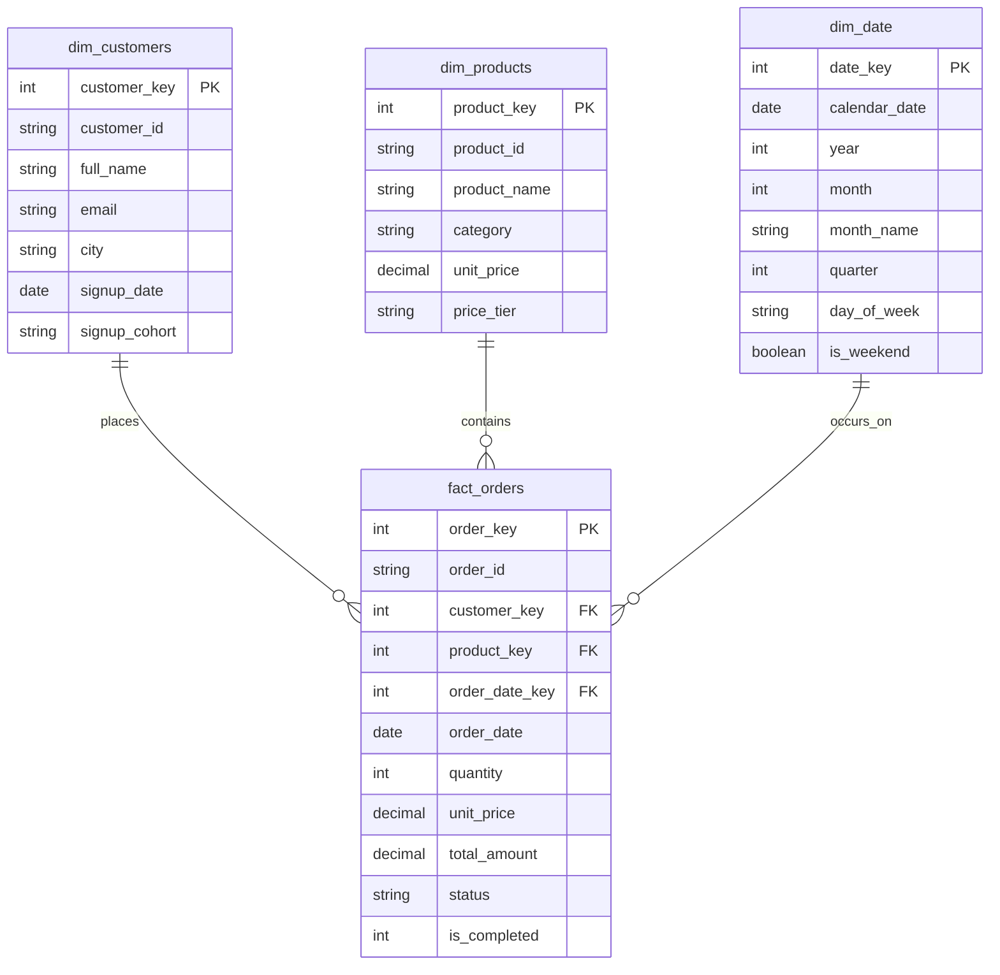

# 🛒 E-Commerce ELT Pipeline & Dimensional Data Warehouse

An end-to-end analytical data engineering pipeline built using **Python**, **DuckDB**, and **Kimball Dimensional Modeling (Star Schema)**. Demonstrates raw data ingestion, schema modeling, advanced analytical SQL (Window functions, CTEs, offsets), and exporting marts to columnar **Parquet** format.

---

## 🏗️ Architecture & Pipeline Flow

```
   [ Raw CSV Sources ]
   (Customers, Products, Orders)
            │
            ▼  (Python / DuckDB Auto Ingestion)
   [ Staging Layer (stg_) ]
   (Data Type Cleaning & Casting)
            │
            ▼  (Kimball Dimensional Modeling)
   [ Star Schema Data Warehouse ]
   ├── dim_customers (Surrogate key, demographics, cohort)
   ├── dim_products  (Categorization, price brackets)
   ├── dim_date      (365-day calendar dimension)
   └── fact_orders   (Central transactional facts & metrics)
            │
     ┌──────┴──────────────────────────┐
     ▼                                 ▼
[ Advanced Analytics Mart ]     [ Columnar Parquet Export ]
(CTEs, RANK, LEAD, LAG)         (Production-ready Storage)
```

---

## 📊 Data Modeling (Star Schema)



---

## 🛠️ Tech Stack & Skills Demonstrated

* **Language:** Python 3.13 (Pipeline automation & synthetic ingestion engine)
* **Analytical Database:** DuckDB (In-process OLAP database engine)
* **Storage Formats:** CSV (Raw Landing), Parquet (Columnar Gold Storage)
* **SQL Techniques:**
  * **Common Table Expressions (`WITH ... AS`):** Modular, readable pipeline steps.
  * **Window Ranking (`DENSE_RANK() OVER (PARTITION BY ...)`):** City-wise customer spending rankings.
  * **Offset Window Functions (`LAG()` / `LEAD()`):** Month-over-Month (MoM) revenue growth & customer purchase interval calculation.
  * **Cumulative Running Aggregations:** Tracking cumulative company revenue throughout the year.

---

## 🚀 How to Run the Pipeline

### 1. Prerequisites
Ensure Python is installed, then install DuckDB:
```bash
pip install duckdb
```

### 2. Generate Raw Data (Optional - files already included)
```bash
python data/generate_raw_data.py
```

### 3. Run the Entire Pipeline & Analytics Engine
```bash
python run_pipeline.py
```

---

## 📈 Key Business Insights Generated

1. **Top Spenders by City:** Identified highest value customers in each metropolitan hub using `DENSE_RANK()`.
2. **MoM Revenue Velocity:** Monitored seasonal expansion and contraction using `LAG()` across 2024 order batches.
3. **Repeat Purchase Velocity:** Calculated average days elapsed between repeat orders per customer using `LEAD()`.
4. **Columnar Export:** Automatically exported transformed fact and dimension tables into snappy Parquet format (`data/mart/*.parquet`).

---

## 📄 Resume Bullet Points (Ready to Copy-Paste)

* **E-Commerce ELT Pipeline & Dimensional Warehouse (Python, DuckDB, SQL, Parquet):**
  * Engineered an end-to-end ELT pipeline ingesting multi-source transactional data into an in-process DuckDB analytical warehouse.
  * Architected a **Kimball Star Schema** containing 3 dimension tables (`dim_customers`, `dim_products`, `dim_date`) and a centralized `fact_orders` table to streamline reporting.
  * Authored advanced analytical SQL queries utilizing **CTEs**, **Window Functions** (`DENSE_RANK`, `PARTITION BY`), and offset functions (`LEAD`/`LAG`) to calculate Month-over-Month revenue velocity and customer retention intervals.
  * Implemented an automated export pipeline dumping modeled data into compressed columnar **Parquet** files for optimized analytical consumption.
