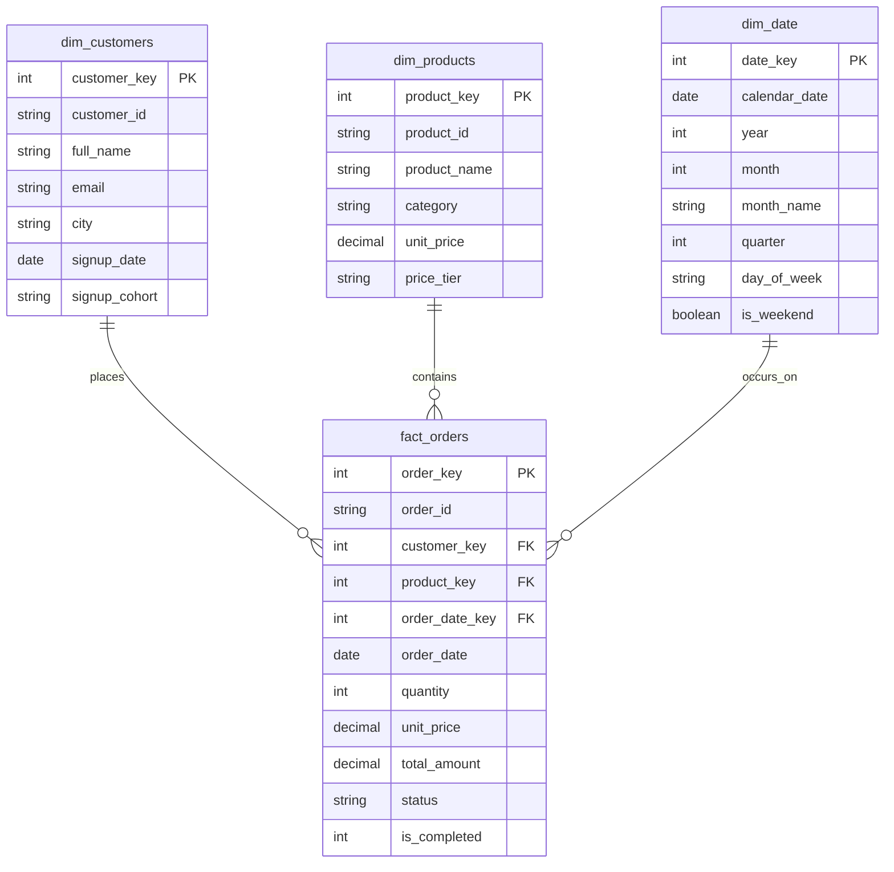

# E-Commerce ELT Pipeline & Data Warehouse

A lightweight, end-to-end ELT data pipeline built with Python, DuckDB, and SQL. 

The project ingests simulated e-commerce data (customers, products, and order transactions), models it into a Kimball Star Schema with fact and dimension tables, and runs analytical SQL queries to calculate business metrics like customer rankings, month-over-month growth, and repeat purchase frequency. Modeled tables are exported to columnar Parquet files.

---

## Architecture

The pipeline follows a standard ELT workflow:

```
[Raw CSVs] 
    │
    ▼ (DuckDB Ingestion)
[Staging Tables] ──> Data type casting and string trimming
    │
    ▼ (SQL Transformations)
[Star Schema Warehouse]
    ├── dim_customers (Customer profiles and signup cohorts)
    ├── dim_products  (Product catalog and price tiers)
    ├── dim_date      (Generated calendar dimension)
    └── fact_orders   (Order transactions with foreign keys)
    │
    ├─► [Analytical SQL Queries] (CTEs, Window Functions, LEAD/LAG)
    └─► [Parquet Export] (Columnar storage in data/mart/)
```

---

## Data Model (Star Schema)

The warehouse uses dimensional modeling to optimize analytical queries:



---

## Tech Stack

* **Language:** Python 3.13
* **Database Engine:** DuckDB (in-process analytical OLAP engine)
* **Data Formats:** CSV (raw sources), Parquet (gold layer storage)
* **SQL Focus:** Common Table Expressions (CTEs), `DENSE_RANK()`, `LEAD()`, `LAG()`, and cumulative window aggregations

---

## Project Structure

```
ecommerce_elt_pipeline/
├── data/
│   ├── raw/                 # Generated raw CSV datasets
│   │   ├── raw_customers.csv
│   │   ├── raw_products.csv
│   │   └── raw_orders.csv
│   ├── mart/                # Exported Parquet files
│   └── generate_raw_data.py # Data generator script
├── sql/
│   ├── 01_staging.sql       # Source ingestion & type casting
│   ├── 02_dimensional_model.sql # Star schema creation
│   └── 03_analytics_queries.sql # Analytical SQL queries
├── run_pipeline.py          # Master runner script
├── .gitignore
└── README.md
```

---

## How to Run

### 1. Install dependencies
```bash
pip install duckdb
```

### 2. (Optional) Re-generate raw datasets
```bash
python data/generate_raw_data.py
```

### 3. Run the complete pipeline
```bash
python run_pipeline.py
```

This single command will:
1. Initialize the DuckDB database (`ecommerce_warehouse.duckdb`).
2. Run `01_staging.sql` to clean and load raw CSVs.
3. Run `02_dimensional_model.sql` to build the Star Schema tables.
4. Execute analytical queries and display results in the console.
5. Export clean dimensional marts to `data/mart/*.parquet`.

---

## Key Analytics Queries Included

* **Top Spenders by City:** Uses `DENSE_RANK() OVER (PARTITION BY city ORDER BY total_spent DESC)` to identify top customers per city while handling ties.
* **Month-over-Month Revenue Growth:** Uses `LAG(revenue, 1)` to compare consecutive monthly revenues and compute percentage change.
* **Customer Repeat Interval:** Uses `LEAD(order_date, 1)` to measure the average elapsed days between a customer's repeat purchases.
* **Cumulative Revenue:** Tracks running sales volume across the year using `SUM() OVER (ORDER BY order_date)`.
